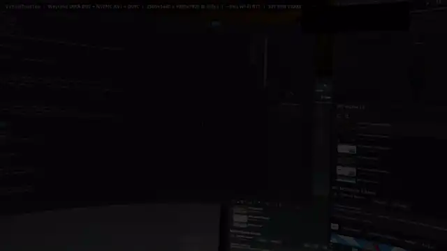

# VirtualRustTop

Native, lightweight Linux-to-Quest virtual desktop streamer written in Rust (Wayland DMA-BUF, NVENC AV1, QUIC, OpenXR).

[](https://github.com/drakkhis/VirtualRustTop/releases/download/v0.1.0/VirtualRustTop-demo.mp4)

*Recorded directly on Meta Quest 3 over Wi-Fi streaming dual Wayland monitors (`2560×1440` + `1080×1920` @ 60 fps, AV1 ABR up to 61 Mbps + 34 Mbps): **~3 ms QUIC RTT (`0.00%` packet loss)** and **~521 MiB host GPU VRAM**. Click preview for the full 1080p 60fps MP4.*

---

## Scope & Expectations

**Tested stack:** **Linux Wayland (KDE Plasma / KWin) + NVIDIA RTX 40-series+ (NVENC AV1) + Meta Quest 3**

> [!IMPORTANT]
> This is a personal "scratch-my-own-itch" project released as-is with **no support guarantees**.
>
> - **PRs are welcome** for AMD (VA-API), Intel (QuickSync), X11 capture, HEVC fallback, other Wayland compositors, or other OpenXR headsets.
> - **Issue tickets requesting support** for untested GPUs, compositors, or headsets are not on the personal roadmap and will likely be closed.

---

## Architecture Overview

```text
Linux Wayland Host (vdesk-host)                         Meta Quest 3 Client (vdesk-quest)
--------------------------------                        ---------------------------------
XDG Portal (ScreenCast + RemoteDesktop)
   └─► PipeWire DMA-BUF (zero-copy GPU textures)
          └─► EGL -> CUDA -> NVENC AV1 + ABR ──QUIC (UDP 9443)──► AMediaCodec (hardware AV1)
                                                                     └─► OpenXR Surface Swapchain
PipeWire Virtual Sink (48 kHz stereo PCM) ───QUIC Datagrams─────► AAudio Low-Latency Ring Buffer
Portal + /dev/uinput (evdev) ◄─────────QUIC (reliable + dgram)─── Controller Raycast & ANSI HUD/KB
UDP Broadcast Responder (UDP 9444) ◄────── LAN Discovery ───────► VDESK_PING Auto-Discovery
```

1. **Zero-Copy Capture & Hardware Encode:** Captures each monitor via XDG Desktop Portal + PipeWire DMA-BUF, imports into EGL/CUDA (`libEGL.so.1` / `libcuda.so.1` / `libnvidia-encode.so.1` loaded dynamically at runtime), and encodes low-latency AV1 (`P1`, zero B-frames) with 500 ms QUIC Adaptive Bitrate (ABR).
2. **Multiplexed QUIC Transport:** Uses `quinn` + `rustls` over UDP `9443` with persistent per-monitor unidirectional video streams (no cross-monitor head-of-line blocking), a reliable bidirectional control/keystroke stream, and unreliable datagrams for pointer motion and audio.
3. **Native Quest 3 OpenXR + Vulkan Client:** Renders monitors onto curved cylindrical OpenXR composition layers in mixed-reality passthrough (`XR_FB_passthrough` + `XR_FB_composition_layer_settings` sharpening/supersampling), decoding directly into `ANativeWindow` swapchain surfaces via `AMediaCodec`.
4. **Spatial Controls & Input:** Full-size dual-hand 104-key US ANSI virtual keyboard, per-screen visibility/6DOF headlock controls, 2D One-Euro + click/drag pointer stabilization, Bluetooth keyboard passthrough, and host `/dev/uinput` + Portal input injection.

---

## Features

- **Multi-Monitor Cylindrical Workspace:** Automatically arranges multiple Wayland monitors around a shared 1.8 m arc according to their Wayland logical coordinates, with grab-to-reposition, depth/arc resize, per-screen Hide/Show, and 6DOF headlock.
- **Automatic Audio Routing:** Creates a temporary PipeWire null sink (`VirtualRustTop Quest 3`) while a headset is connected, routes desktop audio to the Quest 3 at 48 kHz stereo, and restores your previous output device on disconnect.
- **LAN Auto-Discovery:** Quest client discovers the host automatically via UDP broadcast on port `9444` (with optional `host.txt` fallback for broadcast-restricted networks).
- **System Tray Mode:** Optional `--tray` controller (KDE / Freedesktop StatusNotifierItem) for managing `vdesk-host.service`.

---

## Workspace Crates

| Crate | Description |
| :--- | :--- |
| [`crates/vdesk-protocol`](crates/vdesk-protocol) | Shared `postcard`-serialized control, video frame header, audio packet, and input protocol (`ALPN: vdesk-xr/1`). |
| [`crates/vdesk-host`](crates/vdesk-host) | Linux Wayland streamer, EGL/CUDA/NVENC AV1 encoder, PipeWire audio router, `/dev/uinput` injector, and tray service. |
| [`crates/vdesk-quest`](crates/vdesk-quest) | Native Meta Quest 3 OpenXR + Vulkan Android client (`aarch64-linux-android`). |

---

## Quickstart

### 1. Host Prerequisites (Linux)

- **Wayland** desktop session with `xdg-desktop-portal` (`ScreenCast` and `RemoteDesktop` portals) and **PipeWire** (`pactl` available for sink switching).
- **NVIDIA RTX 40-series or newer** with proprietary NVIDIA drivers providing `libEGL.so.1`, `libcuda.so.1`, and `libnvidia-encode.so.1` (hardware AV1 NVENC).
- **Rust toolchain** (`cargo`, `rustc`) and build dependencies:
  - Arch Linux: `pipewire clang pkgconf`
  - Debian / Ubuntu: `libpipewire-0.3-dev libspa-0.2-dev pkg-config libclang-dev`
  - Fedora: `pipewire-devel clang pkgconf-pkg-config`

### 2. Configure `/dev/uinput` Permissions

Install the udev rule so `vdesk-host` can create its virtual mouse/keyboard device without root:

```bash
sudo cp udev/99-vdesk-uinput.rules /etc/udev/rules.d/
sudo udevadm control --reload-rules
sudo udevadm trigger
```

If your user is not already in the `input` group, add it and re-login:

```bash
sudo usermod -aG input "$USER"
```

### 3. Build & Run the Host

```bash
cargo build --release -p vdesk-host
./target/release/vdesk-host
```

- On first launch, approve the XDG Desktop Portal screen-sharing & remote-desktop dialog (a persistent restore token is saved to `$XDG_CONFIG_HOME/vdesk-rs/portal_restore_token`).
- Allow **UDP `9443`** (QUIC stream) and **UDP `9444`** (LAN auto-discovery) through your local firewall:

  ```bash
  # UFW (Ubuntu / Debian / Arch) — allow both QUIC (9443) and LAN discovery (9444)
  sudo ufw allow 9443:9444/udp
  # Or restrict to your LAN subnet:
  # sudo ufw allow from 192.168.1.0/24 to any port 9443:9444 proto udp

  # firewalld (Fedora / RHEL)
  sudo firewall-cmd --add-port=9443-9444/udp --permanent && sudo firewall-cmd --reload
  ```

#### Host CLI Flags & Environment Variables

Run `./target/release/vdesk-host --help` for the full list:

| Flag | Env Var | Default | Description |
| :--- | :--- | :--- | :--- |
| `--port <PORT>` | `VDESK_PORT` | `9443` | QUIC UDP listen port. |
| `--discover-port <PORT>` | `VDESK_DISCOVER_PORT` | `9444` | UDP LAN auto-discovery responder port (`0` disables discovery). |
| `--max-fps <FPS>` | `VDESK_MAX_FPS` | `60` | Maximum capture/encode rate (`30`–`120`). |
| `--bitrate-kbps <KBPS>` | `VDESK_BITRATE_KBPS` | auto | Fixed target bitrate override in kbps (auto-scaled by monitor resolution when unset). |
| `--no-audio` | `VDESK_NO_AUDIO` | `false` | Disable PipeWire virtual audio sink routing. |
| `--tray` | — | `false` | Run the KDE / Freedesktop system tray controller instead of the streamer. |
| `--service <UNIT>` | `VDESK_SERVICE_NAME` | `vdesk-host.service` | Systemd user unit managed by `--tray`. |
| `--test-uinput` | — | — | Verify `/dev/uinput` virtual device registration and exit. |
| `--test-portal` | — | — | Verify XDG Desktop Portal initialization and exit. |
| `--dump-frames <N>` | — | — | Dump `N` encoded AV1 frames from the primary monitor to `--dump-output` (`vdesk_dump.av1`). |
| `--wiggle-uinput <N>` | — | — | Inject `N` synthetic pointer events via `/dev/uinput` and exit. |

#### Optional: Run Host via systemd + Tray Icon

A portable user unit template is provided at [`contrib/systemd/vdesk-host.service`](contrib/systemd/vdesk-host.service):

```bash
install -Dm755 target/release/vdesk-host ~/.local/bin/vdesk-host
install -Dm644 contrib/systemd/vdesk-host.service ~/.config/systemd/user/vdesk-host.service
systemctl --user daemon-reload
systemctl --user enable --now vdesk-host.service

# Optional KDE/Freedesktop system tray controller:
~/.local/bin/vdesk-host --tray
```

### 4. Install the Quest 3 App

Download the pre-built **`VirtualRustTop-quest3.apk`** from [GitHub Releases](https://github.com/drakkhis/VirtualRustTop/releases) and sideload it over USB/ADB (requires Meta Quest Developer Mode enabled):

```bash
adb install -r VirtualRustTop-quest3.apk
```

Or install via SideQuest / your preferred Quest sideloader, then launch **`vdesk-rs`** from **App Library → Unknown Sources**.

> **Network Discovery & Broadcast-Blocked LANs:**
> By default, `vdesk-quest` broadcasts `VDESK_PING` on UDP `9444` to locate `vdesk-host` automatically. If your router/VLAN blocks UDP broadcasts, push a `host.txt` file containing your host PC's LAN IP (or `IP:PORT`) to the app's external files directory:
> ```bash
> echo "<HOST_LAN_IP>:9443" > /tmp/host.txt
> adb push /tmp/host.txt /sdcard/Android/data/com.vdesk.quest/files/host.txt
> ```

---

## Building the Quest Client from Source

<details>
<summary>Expand for Android SDK / NDK / cargo-apk build instructions</summary>

Building the Quest APK from source is optional — pre-built APKs are provided in GitHub Releases.

**Tested build environment:**
- Rust `aarch64-linux-android` target (`rustup target add aarch64-linux-android`)
- `cargo-apk` `0.10.0` (`cargo install cargo-apk --version 0.10.0`)
- Android SDK Platform **API 32** (`android-32`), Build-Tools **37.0.0**
- Android NDK **r30** (`30.0.16248370`)
- `adb` & `keytool` (JDK)

Quick local build (signed with `~/.android/debug.keystore` for local sideloading):

```bash
./scripts/build_quest_apk.sh --debug-sign
adb install -r dist/VirtualRustTop-quest3.apk
```

For full signing and environment setup details, see [docs/BUILDING_ANDROID.md](docs/BUILDING_ANDROID.md).

</details>

---

## Quest 3 Controls

| Input | Action |
| :--- | :--- |
| **Right Trigger** or **A** | Left click on monitor / press key on virtual keyboard |
| **Left Trigger** | Right click on monitor / press key on virtual keyboard (left hand) |
| **B** or **Right Thumbstick Click** | Right click |
| **Right Thumbstick** | 2D scroll (when pointing at a monitor) |
| **Hold Right Grip** | Grab and reposition a monitor (including headlocked monitors) or the HUD/keyboard |
| **Right Grip + Thumbstick X** | Move grabbed monitor or keyboard closer / farther |
| **Right Grip + Thumbstick Y** | Resize grabbed monitor curvature/arc |
| **Hold Right Grip on Screen + A** | Toggle 6DOF Headlock (pin screen to your view so it moves with you) |
| **Hold Right Grip on HUD/Keyboard + A** | Toggle 6DOF `Follow` on the HUD/keyboard (also via the `Follow` media button) |
| **Hold Right Grip on Screen + B** | Hide the grabbed screen (toggle back from the HUD or Screens panel) |
| **X** (Left Controller) | Toggle 104-key US ANSI virtual keyboard |
| **Y** (Left Controller) | Recenter unpinned / unlocked monitors and HUD |
| **Left Thumbstick Click** | Summon / toggle the Screens management panel |
| **Hold Right Meta Button** | Summon and center all screens (unhiding & unlocking) to default centered position |
| **Click in Open Space (Trigger / A off-screen)** | Show / toggle the always-following HUD dock (auto-hides when idle or on desktop interaction) |
| **Collapsed HUD Dock** | Always follows your view; direct per-screen Show/Hide toggles, plus Keyboard, Screens, Pin, and Center |
| **Keyboard Media Bay (Top-Right)** | `Hide`, `Pin`, and `Follow` (6DOF keyboard headlock) below the volume roller |

---

## License & Third-Party Notices

Licensed under either of:

- **MIT License** ([LICENSE-MIT](LICENSE-MIT))
- **Apache License, Version 2.0** ([LICENSE-APACHE](LICENSE-APACHE))

at your option.

See [THIRD_PARTY_NOTICES.md](THIRD_PARTY_NOTICES.md) for license attributions covering the bundled Khronos OpenXR Android loader (`libopenxr_loader.so`) and `OpenSans-Bold.ttf` font.
